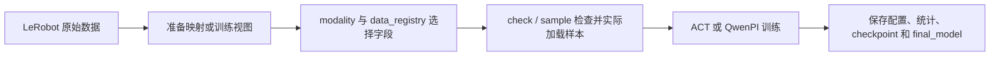

# CS 服务器 LT 五个动作训练说明

核验日期：2026-11-23。依据是 CS 服务器上的启动脚本、完成训练时保存的 `config.full.yaml`、日志中的 `Command` / `PREFLIGHT_OK`、`summary.jsonl` 和最终权重。

本文按 **Suck、Place、Snap、Insert、Push/Pull 五个动作／数据集**组织，不把同一动作的不同模型重复计数。**Place 使用 QwenPI v3 V2**。Suck 主示例使用 QwenPI v3 V2，同一动作已有的 ACT V2 和 QwenPI V3 作为版本附表列出；Snap、Insert 使用 ACT V2，Push/Pull 使用 QwenPI v3 V2。

## 1. 五个动作分别怎样训练

Suck 使用右臂 `arm_0`，另外四个动作使用左臂 `arm_1`。全部使用绝对目标位姿、H50、224×224 图像。数据格式为 LeRobot v3.0，原始采样频率 30 FPS。没有使用 FT 力／力矩输入。

| 动作 | 本说明主模型 | 每卡 BS | 完成步数 | Warmup | 保存间隔 |
|---|---|---:|---:|---:|---:|
| Suck | QwenPI v3 V2 | 4 | 20,000 | 500 | 5,000 |
| Place | QwenPI v3 V2 | 8 | 20,000 | 500 | 5,000 |
| Snap | ACT V2，新版 | 16 | 80,000 | 5,000 | 10,000 |
| Insert | ACT V2，新版 | 16 | 80,000 | 5,000 | 10,000 |
| Push/Pull | QwenPI v3 V2 | 8 | 20,000 | 500 | 5,000 |

有效总 BS = 每卡 BS × GPU 进程数 × 梯度累积；这些配方的梯度累积均为 1。Place 和 Push/Pull 的完成日志确认使用 2 个进程，有效总 BS16；Snap、Insert 各用 1 个进程。Suck 的旧启动日志目前未保留，因此只依据最终配置记录每卡 BS，不推断其历史进程数。

`--steps` 是优化器更新次数，不是 episode 数或机器人运动步数。H50 表示每个样本监督未来 50 个动作，不能再把 BS 乘以 50。

### Suck 同一动作的已有版本

| 版本 | 每卡 BS | 完成步数 | State | 相机顺序 |
|---|---:|---:|---|---|
| QwenPI v3 V2，本文主示例 | 4 | 20,000 | 右臂 pose 7 + DI 17 = 24 | left_side、right_wrist、right_side |
| QwenPI v3 V3 | 2 | 20,000 | 只有右臂 pose 7，不输入 DI | left_side、right_wrist、right_side |
| ACT V2 | 16 | 80,000 | 右臂 pose 7 + DI 17 = 24 | left_side、left_wrist、right_wrist、right_side |

三个版本的 Action 均为右臂目标 pose 7 + DO8、9、10、11，共 11 维；它们属于一个 Suck 动作，不额外算三个动作。V2/V3 表示数据输入映射版本。

**启动脚本默认值与实际完成的实验参数有区别**：QwenPI 启动脚本默认每卡 BS1；实际 Suck V2 使用 BS4，Place 和 Push/Pull 使用 BS8。Snap / Insert 曾用 BS2 试训、续训，但本文对应的是之后从头训练完成的 BS16 / 80k 新版。

实际配置快照和动作训练记录随本文保存：

- [五个动作及 Suck 版本的配置依据、命令、日志与产物路径](training_records/runs_20261123.json)
- [Suck QwenPI V2 实际配置](training_records/dualarm_lt_suck_qwenpi_v3_v2_h50.yaml)
- [Suck QwenPI V3 实际配置](training_records/dualarm_lt_suck_qwenpi_v3_v3_h50.yaml)
- [Suck ACT V2 实际配置](training_records/dualarm_lt_suck_act_h50_v2.yaml)
- [Place QwenPI 实际配置](training_records/dualarm_lt_place_qwenpi_v3_v2_h50.yaml)
- [Snap ACT 新版实际配置](training_records/dualarm_lt_snap_act_h50_v2_bs16_80k_20261122_065928_14701.yaml)
- [Insert ACT 新版实际配置](training_records/dualarm_lt_insert_act_h50_v2_bs16_80k_20261122_065931_14779.yaml)
- [Push/Pull QwenPI 实际配置](training_records/dualarm_lt_push_pull_qwenpi_v3_v2_h50.yaml)

这些快照保留 CS 的绝对路径，用于说明实际实验。换机器时需要调整数据、基座模型、预训练 checkpoint 和缓存路径。

## 2. CS 的目录与运行环境

| 内容 | CS 路径 |
|---|---|
| 训练项目 | `/root/data/starVLA` |
| 训练 Python | `/root/data/starVLA/.venv/bin/python` |
| Accelerate | `/root/data/starVLA/.venv/bin/accelerate` |
| 原始数据和训练视图 | `/root/data/datasets` |
| 基座模型、预训练 checkpoint | `/root/data/models` |
| mmap 图像缓存 | `/root/data/cache/starvla` |
| 训练日志 | `/root/data/logs/starvla` |
| 模型输出 | `/root/data/outputs/starVLA` |
| 独立 ModelScope 下载环境 | `/root/data/venv/modelscope-lt-tools` |

实际训练使用既有 `.venv`，不需要为每个动作创建一个训练环境。GPU 型号和分配曾随实例变化，运行前以当前设备为准：

```bash
cd /root/data/starVLA
nvidia-smi
.venv/bin/python -c 'import torch; print(torch.__version__, torch.cuda.is_available(), torch.cuda.device_count())'
df -h /root/data
```

QwenPI 是 4B VLM 加动作头的全参数训练，显存需求显著高于 ACT；BS8 是已完成大显存环境中的实际参数，不表示任意 GPU 都能使用 BS8。DeepSpeed 配置位于 `starVLA/config/deepseeds/deepspeed_zero2.yaml`。

## 3. 数据如何变成训练样本



### 数据量与任务

| 原始数据 | 训练视图 | 示教条数 | 帧数 | 相机顺序 |
|---|---|---:|---:|---|
| `suck_lt` | 直接使用 `suck_lt` | 196 | 82,827 | QwenPI：`left_side`, `right_wrist`, `right_side` |
| `place_lt` | `place_lt_v2` | 203 | 46,102 | `left_wrist`, `right_side` |
| `snap_lt` | `snap_lt_v2` | 111 | 15,188 | `left_wrist`, `right_side` |
| `insert_lt` | `insert_lt_v2` | 106 | 14,254 | `left_wrist`, `right_side` |
| `push_pull_lt` | `push_pull_lt_v2` | 377 | 128,271 | `left_wrist`, `left_side` |

Suck 的既有 `modality.json` 与对应 `data_registry` 选择右臂字段；训练前由 Suck 启动脚本校验。其他四个动作的 `prepare_*.py` 不修改原始数据；它创建带独立 `meta/modality.json` 的训练视图，通过软链接复用原始数据和视频。原始目录必须保留。

Snap / Insert 使用 ModelScope 数据集 `chaishan/huashu` 中的：

```text
newsmy_usb_h264_640x400_30fps_20261120_4cam/Snap-c
newsmy_usb_h264_640x400_30fps_20261120_4cam/Insert-c
```

有权限的 ModelScope 账号登录后，可以重复运行：

```bash
cd /root/data/starVLA
examples/realRobots/dualarmLTSnapInsert/train_files/download_snap_insert.sh
```

下载器验证原始文件 SHA-256；完整文件会跳过。训练只选指定的两个相机。Place / Push/Pull 的原始 LeRobot 数据已放在对应数据目录，准备脚本基于这些目录创建视图。

### 位姿、State 和 Action

```text
pose = [x, y, z, qx, qy, qz, qw]
右臂原始 pose 切片 = cartesian_position[0:7]
左臂原始 pose 切片 = cartesian_position[7:14]

State 24维 = [所选机械臂当前 pose 7维,
 DI4, DI6, DI8, DI9, DI10, DI11, DI12, DI13, DI14, DI15, DI16, DI17,
 DI18, DI19, DI20, DI21, DI22]

Suck Action 11维 = [右臂绝对目标 pose 7维, DO8, DO9, DO10, DO11]
Place / Snap / Insert Action 11维 = [左臂绝对目标 pose 7维, DO12, DO13, DO15, DO16]
Push/Pull Action 9维 = [左臂绝对目标 pose 7维, DO14, DO17]
```

Suck QwenPI V3 是例外，其 State 仅包含右臂 pose 7 维，不输入下面的 17 个 DI。

DI 是两臂的全局反馈；不是只保留动作对应的几个 DI。所有位姿动作都是 `abs`，不表示单步位置增量。

| 动作输出 | 硬件 |
|---|---|
| DO8、DO9 | 右臂左、右吸嘴 |
| DO10、DO11 | 右臂左、右升降气缸 |
| DO12、DO13 | 左臂左、右吸嘴 |
| DO15、DO16 | 左臂左、右升降气缸 |
| DO14 | 左臂中间吸嘴 |
| DO17 | 左臂中间升降气缸 |

DI18、DI19 是右臂左、右吸嘴真空反馈。DI20、DI21、DI22 分别为左臂左、右、中间吸嘴的真空反馈；DI12–DI17 是左臂三组气缸的上下到位反馈。

原始 DO 顺序为：

```text
[DO4, DO6, DO8, DO9, DO10, DO11, DO12, DO13, DO14, DO15, DO16, DO17]
```

Suck 选索引 `[2,3,4,5]`；Place / Snap / Insert 选索引 `[6,7,9,10]`，**不能使用连续切片 `[6:10]`**；Push/Pull 选 `[8,11]`。位姿采用 q99 归一化，DI/DO 使用 binary 映射。训练产生的 `dataset_statistics.json` 需要随权重一起用于推理。

### 语言与数据版本的实际差异

Suck 的任务是：

```text
Use the suction cup on the robot's right arm to pick up the phone support plate.
```

Snap 的原始 task 是 `Snap`，Insert 是 `Insert`。Push/Pull 同一个模型同时保留两条指令：

```text
Use the robot's left arm to slowly pull out the charger box drawer.
Use the robot's left arm to slowly push in the charger box drawer.
```

**Place 需要区分训练时标签和当前标签。** 已完成 Place QwenPI 训练的 `PREFLIGHT_OK` 记录的是：

```text
Use the robot's left arm to slowly push in the charger box drawer.
```

2026-11-23 当前原始数据的 `meta/tasks.parquet` 则是：

```text
Lower the robot's left arm to place the charger into the charger box drawer.
```

两种文本均原样记入运行记录。QwenPI 使用语言条件，因此下面命令复现架构和超参数时，若直接读取当前数据，会使用当前标签；精确复现旧训练还需要训练当时的数据与任务标签版本。ACT 本配方不以任务语言作为模型条件。

Snap / Insert 的 DO12、DO13、DO15、DO16 在所有训练帧均为 1，没有这四路 DO 开关切换的示教。Push/Pull 的 DO14、DO17 则同时包含 0 和 1。

## 4. 训练脚本分工与检查

| 目录 | 内容 |
|---|---|
| [dualarmLT](README.md) | Suck 的右臂映射、QwenPI V2/V3 与 ACT 既有版本 |
| [dualarmLTPlace](../dualarmLTPlace/README.md) | 本说明只选择 Place QwenPI，使用左臂映射 |
| [dualarmLTSnapInsert](../dualarmLTSnapInsert/README.md) | 两份数据下载、ACT 配置、从头训练与早期续训脚本 |
| [dualarmLTPushPull](../dualarmLTPushPull/README.md) | Push/Pull QwenPI 配置和中间吸嘴、气缸映射 |

Place / Snap / Insert / Push/Pull 的 `train_files` 处理顺序是：

1. `prepare_*.py` 创建训练视图。
2. `check_*.py` 扫描 Parquet、字段、位姿四元数、二值 IO、非连续 DO 索引与相机文件。
3. `data_registry/data_config.py` 注册数据混合、选择相机和字段，执行归一化。
4. `train_*.sh` 组装 `accelerate launch` 命令。
5. `run_*_nohup.sh` 在后台启动，记录 PID，维护 `*_latest.log`。

这四个动作的入口模式如下。Suck 的现有入口只支持 `--check`、`--dry-run`、`--run`，不支持 `--sample`。

| 模式 | 行为 |
|---|---|
| `--check` | 准备视图、完整数据检查 |
| `--sample` | 上述检查，加真实 StarVLA loader 的归一化样本和视频解码 |
| `--dry-run` | 准备、检查并打印训练命令；不启动训练，也不初始化模型 |
| `--run` | 检查通过后启动训练；后台入口自动选择此模式 |

建议先实际加载一个样本：

```bash
cd /root/data/starVLA
examples/realRobots/dualarmLT/train_files/train_qwenpi_v3_v2_h50.sh --check
examples/realRobots/dualarmLTPlace/train_files/train_qwenpi_v3_place_v2_h50.sh --sample
examples/realRobots/dualarmLTSnapInsert/train_files/train_act_snap_v2_h50.sh --sample
examples/realRobots/dualarmLTSnapInsert/train_files/train_act_insert_v2_h50.sh --sample
examples/realRobots/dualarmLTPushPull/train_files/train_qwenpi_v3_push_pull_v2_h50.sh --sample
```

Place / Snap / Insert 应得到 `state=(1,24)`、`action=(50,11)`、两张图片；Push/Pull 应得到 `state=(1,24)`、`action=(50,9)`、两张图片。

## 5. 五个动作的主配方训练命令

以下使用已完成实验的超参数，但为新实验指定新 `run_id`，保留既有输出。每段是独立任务；QwenPI 复现例子各使用两张卡。Snap 和 Insert 可按例各用一张空闲卡并行训练。

### Suck QwenPI V2：每卡 BS4，20k

先执行上一节的 `--check`。下面是两张空闲卡的复现示例；旧日志缺失，示例中的 2 进程不作为历史实际进程数的证明：

```bash
cd /root/data/starVLA
CUDA_VISIBLE_DEVICES=0,1 \
  examples/realRobots/dualarmLT/train_files/run_qwenpi_v3_v2_h50_nohup.sh \
  --num-processes 2 --batch-size 4 --steps 20000 \
  --run-root-dir /root/data/outputs/starVLA/dualarm_lt_suck_qwenpi_v3_v2_h50_repro \
  --run-id dualarm_lt_suck_qwenpi_v3_v2_h50_repro
```

Suck 的 ACT 和 QwenPI V3 也有已完成权重，但不替换本节的主示例；具体 State 与相机差异见第一节。

### Place QwenPI：两卡，每卡 BS8，20k

```bash
cd /root/data/starVLA
CUDA_VISIBLE_DEVICES=0,1 \
  examples/realRobots/dualarmLTPlace/train_files/run_qwenpi_v3_place_v2_h50_nohup.sh \
  --num-processes 2 --batch-size 8 --steps 20000 \
  --run-id dualarm_lt_place_qwenpi_v3_v2_h50_repro
```

### Snap ACT：单卡 BS16，从头训练 80k

```bash
cd /root/data/starVLA
CUDA_VISIBLE_DEVICES=1 \
  examples/realRobots/dualarmLTSnapInsert/train_files/run_act_snap_fresh80k_nohup.sh
```

### Insert ACT：单卡 BS16，从头训练 80k

```bash
cd /root/data/starVLA
CUDA_VISIBLE_DEVICES=0 \
  examples/realRobots/dualarmLTSnapInsert/train_files/run_act_insert_fresh80k_nohup.sh
```

这两个 `fresh80k` 入口检查 `pretrained_checkpoint: null`、不启用 resume，固定 BS16 / 80k，自动生成带时间和 PID 的新 `run_id`。它们只接受可选的 `--dry-run`；要自定义 BS、步数或 run_id，使用下一节的通用入口。

### Push/Pull QwenPI：两卡，每卡 BS8，20k

```bash
cd /root/data/starVLA
CUDA_VISIBLE_DEVICES=0,1 \
  examples/realRobots/dualarmLTPushPull/train_files/run_qwenpi_v3_push_pull_v2_h50_nohup.sh \
  --num-processes 2 --batch-size 8 --steps 20000 --main-process-port 29605 \
  --run-id dualarm_lt_push_pull_qwenpi_v3_v2_h50_repro
```

三个动作的 QwenPI 主配方都使用：

```yaml
framework:
  name: QwenPI_v3
  qwenvl:
    base_vlm: /root/data/models/Qwen3-VL-4B-Instruct-Action
trainer:
  pretrained_checkpoint: /root/data/models/VLAct_Qwen3_Pretrain/checkpoints/steps_100000_pytorch_model.pt
  random_init_action_model: true
  is_resume: false
  learning_rate:
    qwen_vl_interface: 1.0e-5
    action_model: 1.0e-4
    project_layers: 1.0e-4
  num_warmup_steps: 500
  gradient_accumulation_steps: 1
  gradient_checkpointing: true
```

这是相关字段摘要，不是可独立运行的完整 YAML。实际配置使用 LayerwiseFM 动作头，训练每样本重复 2 个 diffusion timestep，默认推理采样 4 步。训练时跳过旧动作头，VLM 和兼容投影从预训练权重初始化；没有启用 LoRA。

## 6. 修改参数、并行运行与内存缓存

通用启动入口支持 `--batch-size`、`--steps`、`--num-processes`、`--run-id`。例如另开一次 Snap BS16 / 100k 实验：

```bash
cd /root/data/starVLA
CUDA_VISIBLE_DEVICES=1 \
  examples/realRobots/dualarmLTSnapInsert/train_files/run_act_snap_v2_h50_nohup.sh \
  --num-processes 1 --batch-size 16 --steps 100000 \
  --main-process-port 29603 --run-id dualarm_lt_snap_act_h50_v2_bs16_100k_r2
```

| 入口 | 通信端口 | 是否支持 `--main-process-port` |
|---|---:|---|
| Suck QwenPI / Place QwenPI | Accelerate 默认 29500 | 当前包装脚本不支持端口参数；这两个动作分开运行 |
| Snap ACT | 29603 | 支持，也支持 `--main_process_port` |
| Insert ACT | 29604 | 支持，也支持 `--main_process_port` |
| Push/Pull QwenPI | 29605 | 支持，也支持 `--main_process_port` |

`CUDA_VISIBLE_DEVICES=0,1` 只开放两张卡，应配 `--num-processes 2`。设为 4 会出现 `GPU_NOT_READY: requested=4 visible=2`。GPU 选择不隔离 TCP 端口；两个独立 DeepSpeed 任务即使各只有一个进程，也需要不同通信端口。

`--steps` 是新的总目标步数。修改磁盘 YAML 不会热更新已经运行的训练进程；实际每次参数以输出目录中的 `config.full.yaml` 和启动日志为准。CLI 会覆盖脚本中的默认 BS / 步数，不能只看源 YAML 判断已完成模型的参数。

这些配方均设置 `load_all_data_for_training: true`。Suck 的保存配置曾使用 `/dev/shm`（QwenPI）或 `/root/data1`（ACT）缓存，复现前要确认目录和空间。两路 224×224 uint8 RGB 的缓存估计：Place 约 12.9 GiB，Snap 与 Insert 合计约 8.3 GiB，Push/Pull 约 36 GiB。实际还需要 metadata 和运行内存；缓存目录在对应 YAML 的 `video_cache_dir`。需要按需解码时，改为 `load_all_data_for_training: false`。

## 7. 从头训练与早期续训的区别

Snap / Insert 的实际过程：

1. BS2 / 20k 初次试训，完成并保存权重。
2. 尝试恢复到总 50k，旧实验保存到了 30k。
3. 之后另建实验目录，**从头以 BS16 训练到 80k**。ModelScope 上的 `bs16_80k` 模型来自这一步。

保留的 `run_act_*_resume50k_nohup.sh` 只用于早期 BS2 实验，不能拿来启动本文的 BS16 / 80k 新训练。它们恢复已有权重和已完成步数，把总目标设为 50k。

当前训练器的 `.pt` checkpoint 保存模型 `state_dict`，没有保存优化器、完整调度器或随机数状态。续训会重新初始化优化器，并把新总步数下的调度器推进到已完成步数；不是完整训练状态的无缝恢复。原试训目录中的 `final_model` 还可能是早先完成 20k 时的文件，选择权重应结合 `summary.jsonl` 和对应日志确认。

## 8. 日志、输出、模型发布

```bash
tail -F /root/data/logs/starvla/place_lt_v2/qwenpi_latest.log
tail -F /root/data/logs/starvla/snap_lt_v2/act_latest.log
tail -F /root/data/logs/starvla/insert_lt_v2/act_latest.log
tail -F /root/data/logs/starvla/push_pull_lt_v2/qwenpi_latest.log
```

Suck 包装脚本约定将日志写入 `/root/data/outputs/starVLA/dualarm_lt_suck_qwenpi_v3_v2_h50/logs/`，历史日志目前未保留。

后台入口打印 `TRAINING_LAUNCH_REQUESTED`（Suck 为 `TRAINING_STARTED`） 只表示已创建后台进程；检查日志里的实际进度、错误以及最终保存结果。`tail -F` 会等待后续日志，即使训练已经退出，看起来也可能“没有动”。按 Ctrl+C 退出日志查看不会停止后台训练。

输出目录会重复包含一次 run_id：

```text
/root/data/outputs/starVLA/<RUN_ID>/<RUN_ID>/
├── config.full.yaml
├── config.yaml
├── dataset_statistics.json
├── summary.jsonl
├── checkpoints/
│   └── steps_<N>_pytorch_model.pt
└── final_model/
    └── pytorch_model.pt
```

`Checkpoint saved at .../steps_20000` 可能打印的是文件名前缀；实际文件为 `steps_20000_pytorch_model.pt`，不是 `steps_20000/` 目录。部分模型发布时只保留最终权重，是否仍有中间 checkpoint 要以目录实际内容为准。

| 模型 | 最终 RUN_ID / ModelScope 仓库名 |
|---|---|
| Suck QwenPI V2 | [dualarm_lt_suck_qwenpi_v3_v2_h50](https://modelscope.cn/models/chaishan/dualarm_lt_suck_qwenpi_v3_v2_h50) |
| Place QwenPI | [dualarm_lt_place_qwenpi_v3_v2_h50](https://modelscope.cn/models/chaishan/dualarm_lt_place_qwenpi_v3_v2_h50) |
| Snap ACT | [dualarm_lt_snap_act_h50_v2_bs16_80k_20261122_065928_14701](https://modelscope.cn/models/chaishan/dualarm_lt_snap_act_h50_v2_bs16_80k_20261122_065928_14701) |
| Insert ACT | [dualarm_lt_insert_act_h50_v2_bs16_80k_20261122_065931_14779](https://modelscope.cn/models/chaishan/dualarm_lt_insert_act_h50_v2_bs16_80k_20261122_065931_14779) |
| Push/Pull QwenPI | [dualarm_lt_push_pull_qwenpi_v3_v2_h50](https://modelscope.cn/models/chaishan/dualarm_lt_push_pull_qwenpi_v3_v2_h50) |

集合：[chaishan/lt](https://www.modelscope.cn/collections/chaishan/lt)。发布包包含最终权重、配置、数据统计和映射；GitHub 保存说明、脚本和配置，不包含原始数据、模型大权重或凭据。

## 9. 这份说明如何核验

[五个动作的检查依据](training_records/validation_20261123.json)。Suck 使用数据预检查与 dry-run，另外四个动作使用真实样本加载与 dry-run。

Suck 三种版本已核对完成时保存的配置、步数记录和最终文件；由于原始启动日志缺失，不补造历史命令和进程数。其他四个动作还核对了 `Command` 的 BS / 进程数，以及 `PREFLIGHT_OK` 的字段和 DO 统计。CS 训练基线为提交 `c39ce56dd4e684ca0a566aa37e51f39df5723bd4`，任务目录另外包含本次同步的配置和脚本。

本次只整理五个动作的训练说明、对应配置与训练必要内容，不纳入通用训练 API 及其 smoke 测试配置。已检查文档链接、配置和命令参数，并使用 CS 数据执行预检查／样本加载／dry-run；不会因为整理说明重新启动训练。训练完成不等于已经测得真机成功率，真机表现需按对应客户端、相机顺序、坐标转换和数据统计实际评估。
