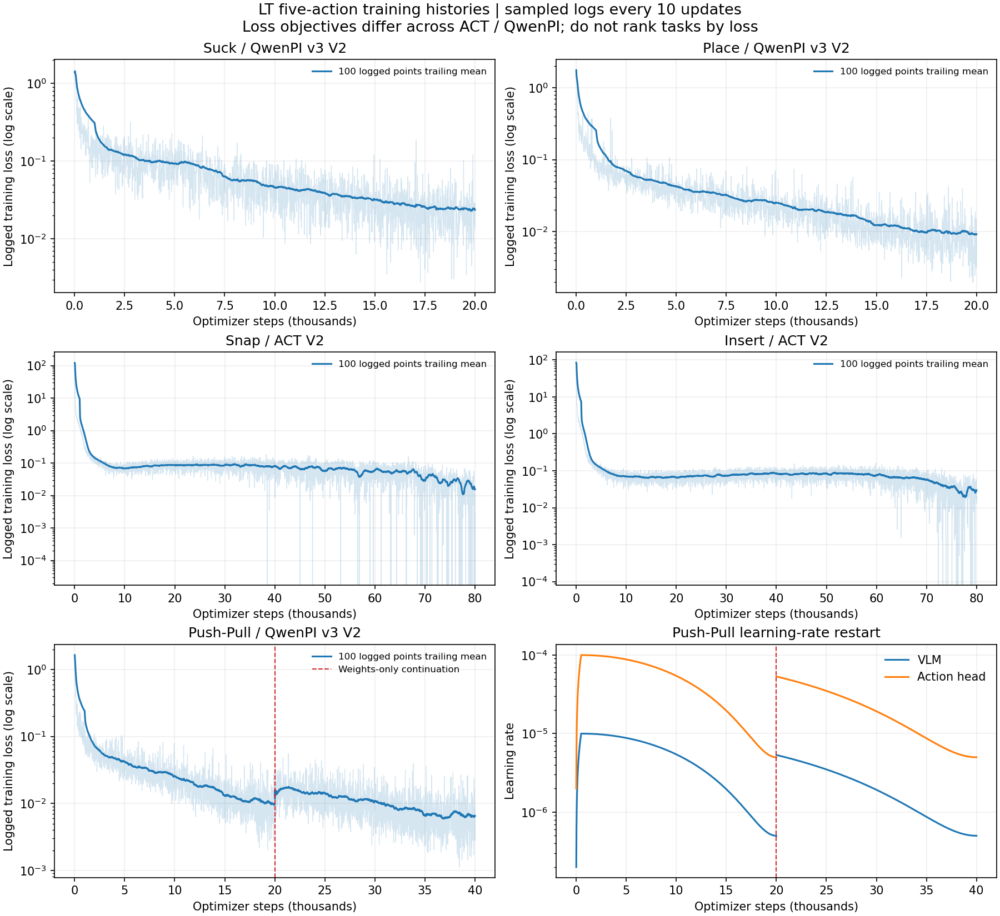
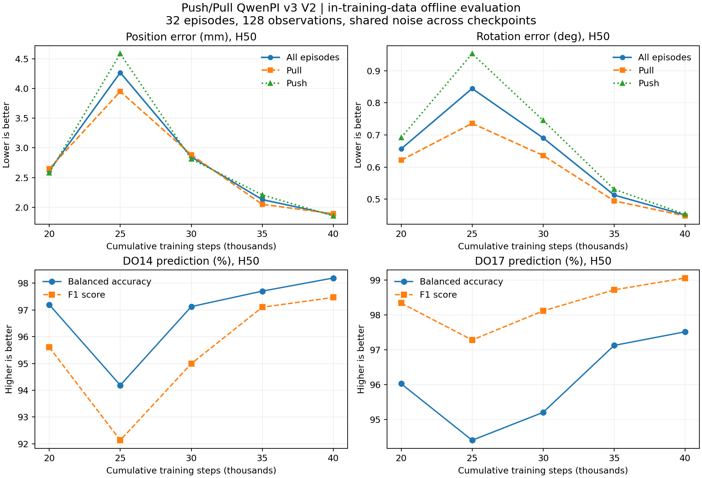

# CS 服务器 LT 五模型训练手册与离线评估报告

更新日期：**2026-11-25**。本手册覆盖 **Suck、Place、Snap、Insert、Push/Pull** 五个动作，各自独立训练、保存权重；Push/Pull 一个模型保留推、拉两条语言指令。

本版以完成实验的配置、实际启动命令、逐步日志、保存事件和权重为依据，沿用《四任务合并训练报告》的“实验设置—训练结果—评测—错误分析—交付—复现”结构。旧报告的 LoRA、14D、H16、2k pilot 参数属于另一批实验，本版采用下表中的全参数 QwenPI / ACT、H50 配方。

**主要结论：**五个主模型均已完成目标训练。Push/Pull 从 20k 继续训练至总 40k；其原训练数据抽样离线评估中，40k 的 H50 位置误差为 **1.873mm**、旋转误差为 **0.451°**，相对 20k 分别降低 **28.35% / 31.39%**。25k 曾退化，35k 起超过 20k，效果随步数非单调变化。该结果是训练数据上的动作预测表现，未测量独立留出集泛化或真机任务成功率。

本次文档整理没有启动新的训练。训练曲线来自已有日志；完整离线评估为同批 128 个观测、两组固定噪声、五个检查点，共 **1,280 次 H50 预测**。随文脚本另做了指标重算及少量推理验证，见[验证记录](training_reports/20261125/data/script_validation.json)。

## 1. 实验设置

### 1.1 五个主模型

| 动作 | 策略 | 完成步数 | 每卡 BS | GPU 进程数 | 有效总 BS | 机械臂 | State / Action |
|---|---|---:|---:|---:|---:|---|---|
| Suck | QwenPI v3 V2 | 20,000 | 4 | 2 | 8 | 右臂 `arm_0` | 24 / 11 |
| Place | **QwenPI v3 V2** | 20,000 | 8 | 2 | 16 | 左臂 `arm_1` | 24 / 11 |
| Snap | ACT V2 | 80,000 | 16 | 1 | 16 | 左臂 `arm_1` | 24 / 11 |
| Insert | ACT V2 | 80,000 | 16 | 1 | 16 | 左臂 `arm_1` | 24 / 11 |
| Push/Pull | QwenPI v3 V2 | **40,000 = 20k + 20k** | 8 | 2 | 16 | 左臂 `arm_1` | 24 / 9 |

有效总 BS = 每卡 BS × 进程数 × 梯度累积；本批梯度累积为 1。`steps` 是优化器更新次数，H50 是每个观测监督的动作长度，不能把有效 BS 再乘以 50。

**Suck 日志依据已补齐。**旧说明曾未找到其完整训练日志。本次在上层 `logs/` 找到 `qwenpi_v3_v2_h50_20261117_115323.log`，确认 2 进程、每卡 BS4；内层失效的 `latest.log` 不能代表原文件不存在。

Suck 另有 ACT V2、QwenPI V3，Push/Pull 另有 ACT 及拆分任务版本；这些版本不额外计入上表的五个主模型。Suck V3 的 State 只有右臂 pose7，不能套用本表 State24 的输入契约。历史版本配置见[旧训练说明](TRAINING_CS_LT.md)和[配置记录](training_records/runs_20261123.json)，当前主模型证据见[新版来源清单](training_reports/20261125/sources.json)。

### 1.2 硬件、环境和目录

| 内容 | 路径或证据 |
|---|---|
| 训练项目 | `/root/data/starVLA` |
| Python / Accelerate | `.venv/bin/python`、`.venv/bin/accelerate` |
| 数据 / 基座模型 | `/root/data/datasets`、`/root/data/models` |
| 图像缓存 | 建议统一放 `/root/data/cache/starvla` |
| 日志 / 输出 | `/root/data/logs/starvla`、`/root/data/outputs/starVLA` |
| DeepSpeed | `starVLA/config/deepseeds/deepspeed_zero2.yaml`，ZeRO-2 |
| 训练代码基线 | CS 核心代码 `c39ce56dd4e684ca0a566aa37e51f39df5723bd4`；任务脚本和映射另外随本仓库保存 |
| 历史训练设备 | 会话期间核验过 A800 80GB；并非每个运行都保存了独立 GPU 型号快照，进程数以日志为准 |
| 本次离线评估 | 单张 NVIDIA A16，15,356MiB 显存，容器系统内存上限 7GiB |
| 环境版本记录 | [本次采集快照](training_reports/20261125/data/current_environment.json)、[完整评估环境与代码 SHA](training_reports/20261125/data/offline_environment.json) |

当前 A16 只验证了本模型的单样本离线推理，不能据此认为它能复现双卡、每卡 BS8 的 QwenPI 全参数训练。训练前检查实际卡数、占用和数据盘容量，不自动改变实例规格。

```bash
cd /root/data/starVLA
nvidia-smi
.venv/bin/python -c 'import torch; print(torch.__version__, torch.cuda.is_available(), torch.cuda.device_count())'
df -h /root/data
```

当前环境快照不能替代每次训练的完整依赖锁；复现时保留当时使用的 Torch、Transformers、LeRobot、Accelerate、DeepSpeed 版本。离线评估所需五个核心源码文件已与当前仓库对应文件逐一核对 SHA-256。

### 1.3 数据量、相机与映射修改

| 原始数据 | 训练视图 | 轨迹数 | 帧数 | 相机输入顺序 | 数据修改方式 |
|---|---|---:|---:|---|---|
| `suck_lt` | 直接使用原目录的字段映射 | 196 | 82,827 | `left_side → right_wrist → right_side` | 选择右臂、17 路 DI 和 4 路 DO，排除另一臂 pose、FT、base 和 left_wrist |
| `place_lt` | `place_lt_v2` | 203 | 46,102 | `left_wrist → right_side` | 独立 modality，软链接复用原始数据/视频 |
| `snap_lt` | `snap_lt_v2` | 111 | 15,188 | `left_wrist → right_side` | 同上，保留原始文件 |
| `insert_lt` | `insert_lt_v2` | 106 | 14,254 | `left_wrist → right_side` | 同上，保留原始文件 |
| `push_pull_lt` | `push_pull_lt_v2` | 377 | 128,271 | `left_wrist → left_side` | 同上，仅输出 DO14、DO17，保留推/拉语言任务 |
| **合计** | 五份独立数据 | **993** | **286,642** | 全部 30FPS、224×224 | 不表示训练已逐帧均匀遍历 |

相机标记：1=使用，0=未使用；实际顺序仍以上表为准。

| 动作 | left_wrist | right_wrist | left_side | right_side | base |
|---|---:|---:|---:|---:|---:|
| Suck QwenPI V2 | 0 | 1 | 1 | 1 | 0 |
| Place QwenPI | 1 | 0 | 0 | 1 | 0 |
| Snap ACT | 1 | 0 | 0 | 1 | 0 |
| Insert ACT | 1 | 0 | 0 | 1 | 0 |
| Push/Pull QwenPI | 1 | 0 | 1 | 0 | 0 |

Snap / Insert 下载入口为 `examples/realRobots/dualarmLTSnapInsert/train_files/download_snap_insert.sh`；来源是 `chaishan/huashu` 下 `newsmy_usb_h264_640x400_30fps_20261120_4cam/Snap-c` 和 `Insert-c`。使用既有账号登录，不把 token 写入手册或仓库。

图像缓存大小按 `frames × cameras × 224 × 224 × 3 bytes` 估算。Push/Pull 两路约 36GiB，Suck 三路约 35GiB，此外还有模型和中间 checkpoint。QwenPI 每份完整权重约 10.9GB，保存多个检查点会继续占用空间。原 Suck 配置曾把缓存放在 `/dev/shm`，本手册的复现命令将新缓存放入数据盘。

### 1.4 State、Action、DI/DO 的确切定义

```text
pose = [x, y, z, qx, qy, qz, qw]
右臂 arm_0 = 原始 cartesian_position[0:7]
左臂 arm_1 = 原始 cartesian_position[7:14]

State24 = [所选臂当前 pose7,
 DI4, DI6, DI8, DI9, DI10, DI11, DI12, DI13, DI14, DI15, DI16, DI17,
 DI18, DI19, DI20, DI21, DI22]

Suck Action11 = [右臂绝对目标 pose7, DO8, DO9, DO10, DO11]
Place / Snap / Insert Action11 = [左臂绝对目标 pose7, DO12, DO13, DO15, DO16]
Push/Pull Action9 = [左臂绝对目标 pose7, DO14, DO17]
```

位置单位为米，姿态为 xyzw 四元数。模型动作是数据集坐标系下的**绝对目标位姿**；控制器坐标转换属于匹配客户端，不由训练维度自动决定。

原始 `action.digital_output` 顺序是：

```text
[DO4, DO6, DO8, DO9, DO10, DO11, DO12, DO13, DO14, DO15, DO16, DO17]
Suck 索引             [2,3,4,5]
Place/Snap/Insert 索引 [6,7,9,10]  # 非连续，不能写成 [6:10]
Push/Pull 索引        [8,11]
```

| 信号 | 硬件含义 |
|---|---|
| DO8、DO9 / DO10、DO11 | 右臂左、右吸嘴 / 左、右升降气缸 |
| DO12、DO13 / DO15、DO16 | 左臂左、右吸嘴 / 左、右升降气缸 |
| DO14 / DO17 | 左臂中间吸嘴 / 中间升降气缸 |
| DI18、DI19 | 右臂左、右真空反馈 |
| DI20、DI21、DI22 | 左臂左、右、中间真空反馈 |
| DI8～DI17 | 两臂升降气缸上下到位反馈，按原始 DI 顺序输入 |

位姿使用 q99 归一化：q01 对应 -1、q99 对应 +1，当前实现将超出部分截到 [-2.2,2.2]；DI/DO 使用 binary 映射。统计文件必须随模型使用，不能从别的任务复制。FT 和另一臂 pose 仍可存在于原数据中，但不进入这五个主模型的 State。

### 1.5 任务文本和数据质量

- Suck：`Use the suction cup on the robot's right arm to pick up the phone support plate.`
- Snap：`Snap`；Insert：`Insert`。
- Push/Pull 同时保留 `Use the robot's left arm to slowly pull out the charger box drawer.` 与 `Use the robot's left arm to slowly push in the charger box drawer.`。
- **Place 有版本差异**：已完成训练的日志是 `Use the robot's left arm to slowly push in the charger box drawer.`；后续数据 metadata 则为 `Lower the robot's left arm to place the charger into the charger box drawer.`。QwenPI 使用语言条件，精确复现旧模型还需保留当时的标签版本；只照抄超参、读取新标签会构成一次新实验。
- Snap / Insert 的 DO12、13、15、16 在对应 15,188 / 14,254 帧中全部为 1，没有这些输出的开关切换示教。
- Push/Pull 的 DO14 高电平 49,337 帧，DO17 高电平 103,614 帧，两路都有 0/1。评估时额外报告平衡准确率，避免多数类掩盖问题。
- Place 原数据中 DO14/17 也有活动，但主模型只输出 DO12/13/15/16；不能把被排除信号当作已学习的动作。

原数据质量检查、真实 loader 样本加载和训练前 dry-run 的历史依据见[检查记录](training_records/validation_20261123.json)。本版训练图只审计已记录训练指标，不宣称完成了逐帧去重或独立验证集泄漏审计。

### 1.6 训练超参

| 参数 | Suck / Place / Push-Pull QwenPI | Snap / Insert ACT |
|---|---|---|
| 初始化 | Qwen3-VL-4B-Instruct-Action + VLAct Qwen3 预训练 checkpoint | ImageNet ResNet18 backbone，新的 ACT 策略参数 |
| 微调方式 | VLM、投影和动作头全参数训练；未启用 LoRA | ACTPolicy 训练；无机器人预训练 checkpoint |
| 新任务动作头 | 首次训练 `random_init_action_model=true` | 随新策略初始化 |
| H / 图像尺寸 | 50 / 224×224 | 50 / 224×224 |
| 学习率峰值 | VLM 1e-5，动作头和投影 1e-4 | action_model / base 1e-4 |
| Warmup | 500 | 5,000 |
| 调度 | cosine_with_min_lr，配置 min_lr=5e-7 | cosine_with_min_lr，配置 min_lr=1e-6 |
| 记录 / 保存间隔 | 10 / 5,000 步 | 10 / 10,000 步 |
| 梯度累积 / 裁剪 | 1 / 1.0 | 1 / 1.0 |
| 梯度检查点 | true | false |
| AdamW | betas=(0.9,0.95)，eps=1e-8，weight_decay=1e-8 | 相同 |
| seed / 数据格式 | 42 / LeRobot v3.0、abs 动作 | 相同 |
| diffusion | 训练重复 2 组 timestep；推理 4 次去噪 | 不适用 |

QwenPI 采用 36 层 VLM、1024 维 LayerwiseFM 动作头、32 个目标视觉 token，保存配置启用 `interleave_self_attention=true`。`max_seq_len=1024` 属于动作模块配置，不是 H=1024。完整参数以各次保存的 `config.full.yaml` 为准。

ACT 由 LeRobot ACTPolicy 实现；这批配方不使用语言作为模型条件。TE 是推理端的时序融合配置，不改变上表的训练步数。RTC 同样是推理时的历史动作块引导和调度逻辑，本批没有另训一份“RTC 专用权重”。

## 2. 训练结果与日志图片

### 2.1 五模型完成情况

| 动作 | 目标步数 | 训练循环耗时 | 首条 → 末条已记录 loss | 最后 1,000 步内日志点均值 |
|---|---:|---|---|---:|
| Suck QwenPI | 20,000 | 4:56:00 | 1.391248 → 0.028923 | 0.023623 |
| Place QwenPI | 20,000 | 6:13:48 | 1.757812 → 0.009388 | 0.009203 |
| Snap ACT | 80,000 | 6:03:44 | 122.517418 → 0.003020 | 0.015466 |
| Insert ACT | 80,000 | 6:05:16 | 84.934906 → 0.016988 | 0.029659 |
| Push/Pull QwenPI | 40,000 | 12:35:17，两阶段相加 | 1.645706 → 0.008128 | 0.006507 |

首条记录均为 step10；Push/Pull 续训段首条为 step20010。训练器把两类策略的主 loss 都记录为 `action_dit_loss`，但 ACT 和 QwenPI 的实际目标不同，不能仅凭数字跨任务、跨框架排名能力。末段均值来自最后 1,000 次更新范围内的 100 条日志点，不是每个更新的完整 loss 记录。

六段训练循环计时合计 **35:54:05**。它包含循环中的保存和收尾，不含循环前加载；这些运行分布于不同日期，Snap / Insert 还可并行，因此该合计不是一次连续墙钟耗时，也不是计费时长。

### 2.2 原始日志点和来源

| 阶段 | 记录范围 | 记录点数 | 循环耗时 | 来源 |
|---|---|---:|---|---|
| Suck | 10～20,000 | 2,000 | 4:56:00 | [CSV](training_reports/20261125/data/suck_history.csv) |
| Place | 10～20,000 | 2,000 | 6:13:48 | [CSV](training_reports/20261125/data/place_history.csv) |
| Snap | 10～80,000 | 8,000 | 6:03:44 | [CSV](training_reports/20261125/data/snap_history.csv) |
| Insert | 10～80,000 | 8,000 | 6:05:16 | [CSV](training_reports/20261125/data/insert_history.csv) |
| Push/Pull 原训练 | 10～20,000 | 2,000 | 6:15:50 | [CSV](training_reports/20261125/data/push_pull_history.csv) |
| Push/Pull 续训 | 20,010～40,000 | 2,000 | 6:19:27 | [CSV](training_reports/20261125/data/push_pull_resume40k_history.csv) |

共 24,000 个记录点，全部通过解析和有限数值检查。失败试跑、早期 BS2 Snap/Insert 续训、旧 H16 LoRA pilot 不混入统计。[机器可读汇总](training_reports/20261125/data/training_summary.json)保存日志 SHA-256、配置 SHA-256、步数保存事件、最终文件大小和进程数。

### 2.3 训练图

总览每个面板保留全部日志点和后向 100 个日志点均值；loss 为对数轴。Push/Pull 在 20k 处分段，平滑窗口分别计算；最后一个面板显示续训时学习率重新调度。



单模型图同时包含 loss、学习率和日志中的 model 时间；该 model 时间不等同于包含数据准备、checkpoint 保存的完整墙钟时间。

| 动作 | 完整训练日志图 |
|---|---|
| Suck QwenPI | [loss / LR / model 时间](training_reports/20261125/images/suck_training.png) |
| Place QwenPI | [loss / LR / model 时间](training_reports/20261125/images/place_training.png) |
| Snap ACT | [loss / LR / model 时间](training_reports/20261125/images/snap_training.png) |
| Insert ACT | [loss / LR / model 时间](training_reports/20261125/images/insert_training.png) |
| Push/Pull QwenPI | [20k + 续训 20k](training_reports/20261125/images/push_pull_training.png) |

## 3. 离线评估结果

### 3.1 评估范围与方法

| 项目 | 本次设置 |
|---|---|
| 实际评估模型 | Push/Pull QwenPI v3 V2 |
| 检查点 | 20k、25k、30k、35k、40k |
| 数据 | 原始训练数据，Pull / Push 各随机固定 16 条轨迹，共 32 条 |
| 观测 | 早、中、晚阶段，加 IO 切换附近样本，实际 128 个 |
| 目标 | 每个观测后续 50 个有效动作，不补齐末端 |
| 输入 | left_wrist、left_side；State24；原始任务文本 |
| 采样 | eval 模式、4 次去噪；每观测两组噪声，跨检查点固定 seed |
| 推理方式 | 标准 predict_action，没有 RTC 历史动作块引导 |
| 预测总量 | 128 × 2 × 5 = 1,280 个 H50 预测 |
| 设备 | A16；PyTorch 分配峰值约 10.43GiB |

图像使用训练时同一 RGB 缓存；从原始视频重新解码抽查的图像逐像素一致。目标保留原始物理数值，位姿统计与训练一致。全部检查点严格加载，40k 检查点与已上传 ModelScope 的最终模型 **1,386 个状态张量完全一致**。见[图像核对](training_reports/20261125/data/frame_verification.json)、[权重等价核对](training_reports/20261125/data/final_equivalence.json)、[评估协议与观测索引](training_reports/20261125/data/offline_protocol.json)。

本次未对 Suck、Place、Snap、Insert 做同样的多检查点动作预测比较，它们在此项目下记为“未评估”，不填 0% 成功率。完整 1,280 次评估没有发送机器人 RPC，也没有真机 rollout。

### 3.2 完整 H50 结果

位置误差为三维欧氏距离 mm；旋转为归一化四元数最短夹角 °，处理 q/-q 等价。DO 按 >0.5 二值化，平衡准确率为正、负类召回率的平均。

| 检查点 | 位置误差 mm ↓ | 旋转误差 ° ↓ | DO14 平衡准确率 ↑ | DO17 平衡准确率 ↑ |
|---|---:|---:|---:|---:|
| 保持当前 pose、DO 输出多数类别 | 12.478 | 13.698 | 50.00% | 50.00% |
| 20k | 2.614 | 0.657 | 97.20% | 96.03% |
| 25k | 4.267 | 0.845 | 94.19% | 94.41% |
| 30k | 2.848 | 0.691 | 97.13% | 95.21% |
| 35k | 2.129 | 0.513 | 97.70% | 97.13% |
| **40k** | **1.873** | **0.451** | **98.20%** | **97.52%** |



40k 的 DO14 / DO17 普通准确率分别为 98.61% / 98.52%，F1 分别为 97.47% / 99.06%。DO17 多数时间为开启，普通准确率和 F1 需要结合平衡准确率、混淆矩阵一起看，不能只报多数类表现。

### 3.3 前 10 步及分任务结果

| 检查点 | 前 10 步位置 mm ↓ | 前 10 步旋转 ° ↓ | Pull H50 位置 mm ↓ | Push H50 位置 mm ↓ |
|---|---:|---:|---:|---:|
| 20k | 2.125 | 0.578 | 2.649 | 2.578 |
| 25k | 3.773 | 0.741 | 3.949 | 4.586 |
| 30k | 2.218 | 0.615 | 2.884 | 2.812 |
| 35k | 1.783 | 0.437 | 2.049 | 2.208 |
| 40k | 1.663 | 0.411 | 1.891 | 1.854 |

第 1 步位置误差 35k / 40k 分别为 1.592 / 1.604mm，两者配对区间跨 0，不能说 40k 在每一个单项、每个前缀都更好。完整 H50 的位置、旋转、两路 DO 指标则均以 40k 最好。

### 3.4 配对区间与结论边界

按任务分层、按轨迹聚类进行 5,000 次 bootstrap；误差先在每条轨迹内平均，再给轨迹等权。下面是“当前模型减参考模型”，负数代表改善。

| 比较 | H50 位置差 mm [95% 区间] | H50 旋转差 ° [95% 区间] | 两路 DO 平均错误率差，百分点 [95% 区间] |
|---|---|---|---|
| 25k − 20k | +1.654 [+1.447, +1.871] | +0.188 [+0.132, +0.245] | +1.734 [+1.062, +2.508] |
| 35k − 20k | -0.485 [-0.638, -0.330] | -0.144 [-0.168, -0.121] | -0.730 [-1.273, -0.270] |
| 40k − 20k | -0.741 [-0.884, -0.604] | -0.206 [-0.226, -0.187] | -1.090 [-1.512, -0.727] |
| 40k − 35k | -0.256 [-0.336, -0.171] | -0.062 [-0.084, -0.040] | -0.359 [-0.676, -0.051] |

这是一批训练轨迹的探索性比较，未作多重比较校正，区间不涵盖全部采样噪声或不同训练随机种子的差异。35k、40k 的改善在两组固定噪声下方向一致；原始数值、所有预测前缀和混淆矩阵见[完整指标](training_reports/20261125/data/offline_metrics.json)、[CSV](training_reports/20261125/data/offline_summary.csv)。

**可得结论：**在本批原训练数据的 H50 离线预测中，继续训练到 35k、40k 有改善，40k 为优先候选。**尚不能推出：**未见场景更好、真机抓取/插入成功率提升、RTC 闭环更稳定，或继续增加步数必然更好。

## 4. 错误分析与复现陷阱

| 问题 | 依据 | 处理与影响 |
|---|---|---|
| 25k 离线表现退化 | H50 位置 4.267mm，明显差于 20k 的 2.614mm | 保留多检查点评估，不仅选择步数最大的中途权重 |
| 续训学习率重新升高 | 原 20k 结束：VLM 5e-7、动作头 5e-6；续训起始：约 5.344e-6 / 5.344e-5 | 学习率提高约 10.7 倍，且优化器重建，可能影响早期续训；本实验未单独确认因果 |
| weights-only checkpoint | 保存模型 state_dict，没有优化器、完整随机状态 | 恢复权重和步数，不能称为完全无缝续训 |
| 新目录没有 seed checkpoint | 训练器在输出 checkpoints 中找不到恢复文件时可能回退 | 使用随文续训工具，在新目录链接源检查点，禁止悄悄从零计步 |
| BS 默认值与实际值不同 | QwenPI 脚本默认 BS1，完成实验为 BS4 / BS8 | 以保存配置、Command 和 DeepSpeed 实际值为准 |
| 两张可见 GPU 却请求四进程 | 原失败试跑出现 requested=4、visible=2 | `num-processes` 不大于可见卡数；失败试跑不并入成功训练曲线 |
| 多任务端口冲突 | DeepSpeed 即使单卡也需要通信端口 | 不同独立作业用不同端口，CUDA_VISIBLE_DEVICES 不隔离 TCP 端口 |
| Suck latest 日志链接失效 | 内层链接目标不存在，上层 logs 仍有完整 20k 文件 | 使用来源清单里的实际日期文件，不能只查看 latest |
| Place 任务文字变更 | 完成训练日志与当前 tasks.parquet 不同 | 记录原标签版本；新标签视为新实验条件 |
| Snap / Insert DO 全 1 | 四路输出没有开关变化示教 | 不能把训练收敛视为已学会开关时序 |
| 动作索引错误 | DO12/13/15/16 在原始向量中不连续 | 使用独立切片，并同步修改 registry、action_dim 和统计 |
| 新实例 CPU 内存小 | 本次容器只有 7GiB，低于整份 QwenPI 权重大小 | 内存映射、逐检查点加载、图像只解压一次；不量化，不自动调整实例 |

训练 loss、离线预测误差、真机任务成功率是三类证据。当前没有五任务的独立成功/失败 rollout 表，不报告虚构的错误条数或成功率。

## 5. 交付物与权重位置

### 5.1 主模型发布包

| 动作 | ModelScope 仓库 | 步数 |
|---|---|---:|
| Suck | [dualarm_lt_suck_qwenpi_v3_v2_h50](https://modelscope.cn/models/chaishan/dualarm_lt_suck_qwenpi_v3_v2_h50) | 20k |
| Place | [dualarm_lt_place_qwenpi_v3_v2_h50](https://modelscope.cn/models/chaishan/dualarm_lt_place_qwenpi_v3_v2_h50) | 20k |
| Snap | [BS16 / 80k 模型](https://modelscope.cn/models/chaishan/dualarm_lt_snap_act_h50_v2_bs16_80k_20261122_065928_14701) | 80k |
| Insert | [BS16 / 80k 模型](https://modelscope.cn/models/chaishan/dualarm_lt_insert_act_h50_v2_bs16_80k_20261122_065931_14779) | 80k |
| Push/Pull | [dualarm_lt_push_pull_qwenpi_v3_v2_h50_resume40k](https://modelscope.cn/models/chaishan/dualarm_lt_push_pull_qwenpi_v3_v2_h50_resume40k) | 40k |

Push/Pull 的 [20k 基准包](https://modelscope.cn/models/chaishan/dualarm_lt_push_pull_qwenpi_v3_v2_h50)保留。40k 发布仓库名已去掉时间戳；CS 内部实验目录仍保留原始名字用于追溯。历史 Snap / Insert 仓库名维持原有名称。

发布包至少需要 `final_model/pytorch_model.pt`、保存的配置、`dataset_statistics.json`、字段映射。下载示例：

```python
from modelscope import snapshot_download
model_dir = snapshot_download(
    'chaishan/dualarm_lt_push_pull_qwenpi_v3_v2_h50_resume40k',
    local_dir='/root/data/models/dualarm_lt_push_pull_qwenpi_v3_v2_h50_resume40k',
)
```

### 5.2 本仓库的手册、日志和评估交付

| 内容 | 入口 |
|---|---|
| 本手册 | `TRAINING_HANDBOOK_LT.md` |
| 数据、日志、运行和权重来源 | [sources.json](training_reports/20261125/sources.json) |
| 五模型训练汇总、原日志和配置 SHA | [training_summary.json](training_reports/20261125/data/training_summary.json) |
| 完整训练日志数值 | `training_reports/20261125/data/*_history.csv` |
| 训练图和离线对比图 | `training_reports/20261125/images/` |
| Push/Pull 40k 实际配置 | [config.full.yaml 快照](training_reports/20261125/data/push_pull_resume40k_config.full.yaml) |
| 原先五模型配置 | [training_records](training_records/runs_20261123.json) |
| 离线评估协议和结果 | [数据目录说明](training_reports/20261125/README.md) |
| 可运行脚本与完整参数 | [offline_eval/README.md](offline_eval/README.md) |

GitHub 保存说明、脚本、配置、数值和曲线图；不上传原始训练视频、相机图像快照、大权重、凭据或通用训练 API 测试。CS 原始评估观测和预测保留在：

```text
/root/data/outputs/starVLA/evaluations/push_pull_qwen_20k_40k_20261125/
```

## 6. 复现命令与参数修改

### 6.1 准备环境与数据检查

以下训练命令是新实验示例，本次整理未执行。每段独立运行；双卡 QwenPI 作业结束后再安排其他作业，Snap / Insert 则可各用一张空闲卡并行。

```bash
cd /root/data/starVLA
export LT_ROOT=/root/data/starVLA
export LT_PY="$LT_ROOT/.venv/bin/python"
export LT_TOOLS="$LT_ROOT/examples/realRobots/dualarmLT/offline_eval"
export TMPDIR=/root/data/tmp
export HF_HOME=/root/data/huggingface
export TORCH_HOME=/root/data/torch-cache
export XDG_CACHE_HOME=/root/data/.cache
export WANDB_MODE=disabled

examples/realRobots/dualarmLT/train_files/train_qwenpi_v3_v2_h50.sh --check
examples/realRobots/dualarmLTPlace/train_files/train_qwenpi_v3_place_v2_h50.sh --sample
examples/realRobots/dualarmLTSnapInsert/train_files/train_act_snap_v2_h50.sh --sample
examples/realRobots/dualarmLTSnapInsert/train_files/train_act_insert_v2_h50.sh --sample
examples/realRobots/dualarmLTPushPull/train_files/train_qwenpi_v3_push_pull_v2_h50.sh --sample
```

Place / Snap / Insert 预期 State `(1,24)`、Action `(50,11)`；Push/Pull 为 `(1,24)` / `(50,9)`。Suck 旧入口不支持 `--sample`，使用其预检查。

### 6.2 Suck QwenPI：双卡 BS4、20k

使用原配方，通过训练器参数覆盖缓存到数据盘，并为新实验指定新名字。新命令显式选择端口 29600，不改变原训练记录。

```bash
cd /root/data/starVLA
mkdir -p /root/data/logs/starvla/suck_lt_v2
nohup setsid env CUDA_VISIBLE_DEVICES=0,1 WANDB_MODE=disabled \
  .venv/bin/accelerate launch \
  --config_file starVLA/config/deepseeds/deepspeed_zero2.yaml \
  --num_processes 2 --main_process_port 29600 \
  starVLA/training/train_starvla.py \
  --config_yaml examples/realRobots/dualarmLT/train_files/qwenpi_v3_v2_h50.yaml \
  --datasets.vla_data.per_device_batch_size 4 \
  --datasets.vla_data.video_cache_dir /root/data/cache/starvla/suck_lt_v2_3cam_224_mmap \
  --trainer.max_train_steps 20000 \
  --run_id dualarm_lt_suck_qwenpi_v3_v2_h50_repro_01 \
  --run_root_dir /root/data/outputs/starVLA/dualarm_lt_suck_qwenpi_v3_v2_h50_repro_01 \
  > /root/data/logs/starvla/suck_lt_v2/qwenpi_repro_01.log 2>&1 < /dev/null &
echo "Suck launcher PID=$!"
```

运行前确认新 run_id、日志名未被使用，以及数据盘能容纳缓存和保存点。原包装脚本的历史用法仍见旧手册；此处额外明确了数据盘缓存和端口。

### 6.3 Place QwenPI：双卡 BS8、20k

```bash
cd /root/data/starVLA
CUDA_VISIBLE_DEVICES=0,1 \
  examples/realRobots/dualarmLTPlace/train_files/run_qwenpi_v3_place_v2_h50_nohup.sh \
  --num-processes 2 --batch-size 8 --steps 20000 \
  --run-id dualarm_lt_place_qwenpi_v3_v2_h50_repro_01
```

该入口使用 Accelerate 默认 29500 端口；任务文字版本差异见 1.5。

### 6.4 Snap / Insert ACT：各单卡 BS16，从头 80k

```bash
cd /root/data/starVLA
# 两张卡均空闲时可分别启动；每个 fresh80k 自动生成新 run_id。
CUDA_VISIBLE_DEVICES=1 \
  examples/realRobots/dualarmLTSnapInsert/train_files/run_act_snap_fresh80k_nohup.sh

CUDA_VISIBLE_DEVICES=0 \
  examples/realRobots/dualarmLTSnapInsert/train_files/run_act_insert_fresh80k_nohup.sh
```

`fresh80k` 固定 BS16 / 80k、不恢复旧 BS2 模型，只接受可选 `--dry-run`。端口分别为 Snap 29603、Insert 29604。自定义参数使用通用入口，例如：

```bash
CUDA_VISIBLE_DEVICES=1 \
  examples/realRobots/dualarmLTSnapInsert/train_files/run_act_snap_v2_h50_nohup.sh \
  --num-processes 1 --batch-size 16 --steps 80000 \
  --main-process-port 29603 --run-id dualarm_lt_snap_act_h50_v2_repro_01
```

### 6.5 Push/Pull QwenPI：20k 基准

```bash
cd /root/data/starVLA
CUDA_VISIBLE_DEVICES=0,1 \
  examples/realRobots/dualarmLTPushPull/train_files/run_qwenpi_v3_push_pull_v2_h50_nohup.sh \
  --num-processes 2 --batch-size 8 --steps 20000 --main-process-port 29605 \
  --run-id dualarm_lt_push_pull_qwenpi_v3_v2_h50_repro_01
```

### 6.6 Push/Pull 从已有 20k 继续到总 40k

先打印计划，确认恢复的是哪份权重、增加多少步、保存到哪里：

```bash
cd /root/data/starVLA
.venv/bin/python examples/realRobots/dualarmLT/offline_eval/resume_push_pull_qwen.py \
  --checkpoint /root/data/outputs/starVLA/dualarm_lt_push_pull_qwenpi_v3_v2_h50/dualarm_lt_push_pull_qwenpi_v3_v2_h50/checkpoints/steps_20000_pytorch_model.pt \
  --run-id dualarm_lt_push_pull_qwenpi_v3_v2_h50_resume40k_repro_01 \
  --total-steps 40000 --batch-size 8 --num-processes 2 \
  --main-process-port 29615 --dry-run
```

正式启动时将 `--dry-run` 改为 `--run`，并在命令前加 `CUDA_VISIBLE_DEVICES=0,1`。该工具默认不启动训练；实际运行会检查卡数、端口、存储，创建新目录、链接 20k seed、保存新配置并后台启动。源模型保持原样。`--total-steps 40000` 表示总步数，不是额外再加 40k。

若使用 6.5 新训练出的基准，`--checkpoint` 应改为该新 run 的实际 20k 文件。当前训练器没有优化器状态，续训含义和学习率变化见第 4 节。

### 6.7 修改 BS、步数、相机和动作

- 通用训练入口使用 `--batch-size`、`--steps`、`--num-processes`、`--run-id`。CLI 覆盖配方默认值；以本次输出 `config.full.yaml` 为最终依据。修改磁盘 YAML 不会热更新已经运行的进程。
- `CUDA_VISIBLE_DEVICES=0,1` 对应最多两个进程。改变 GPU 数量后，同时核对有效总 BS、显存和学习率方案。
- 调整相机时修改 data_registry 的 `video_keys`；ACT 还要保持 `framework.image_keys` 与图片顺序一致。已有权重对应的是旧顺序。
- 调整机械臂、DO 或 State 时，同时修改 modality 切片、registry keys/dims、框架 state_dim/action_dim、统计文件；新建实验重新训练。
- q99 与 binary 的映射不能仅在推理端随意替换；推理使用对应权重的 `dataset_statistics.json`。
- 改任务文本需要保留数据版本。QwenPI 使用语言条件；本批 ACT 配方不使用语言条件，但仍须保持轨迹和动作标注一致。

### 6.8 日志和保存点检查

```bash
tail -F /root/data/logs/starvla/place_lt_v2/qwenpi_latest.log
tail -F /root/data/logs/starvla/snap_lt_v2/act_latest.log
tail -F /root/data/logs/starvla/insert_lt_v2/act_latest.log
tail -F /root/data/logs/starvla/push_pull_lt_v2/qwenpi_resume40k_latest.log
```

`LAUNCH_REQUESTED` 只表示后台进程创建了；还要检查日志步数和 `Training complete`。Ctrl+C 退出 `tail` 不会停止训练。保存点通常为 `checkpoints/steps_20000_pytorch_model.pt`，打印的 `steps_20000` 是前缀，不一定有同名目录。`summary.jsonl` 保存事件也不能单独证明某个中间文件当前仍在磁盘上，须检查实际文件。

### 6.9 重新生成训练图

```bash
cd /root/data/starVLA
.venv/bin/python examples/realRobots/dualarmLT/offline_eval/collect_training_logs.py \
  --manifest examples/realRobots/dualarmLT/training_reports/20261125/sources.json \
  --output-dir /root/data/tmp/lt_training_histories_repro

.venv/bin/python examples/realRobots/dualarmLT/offline_eval/plot_training_logs.py \
  --summary /root/data/tmp/lt_training_histories_repro/training_summary.json \
  --output-dir /root/data/tmp/lt_training_histories_repro/images
```

### 6.10 重做离线评估或仅重算结果

完整流程为 **prepare → infer → analyze**，可分别指定输出目录。下面的 `LT_RUN` 指向本批真实内层 40k 运行目录，包含全部五个要比较的检查点。

```bash
cd /root/data/starVLA
export LT_TOOLS=/root/data/starVLA/examples/realRobots/dualarmLT/offline_eval
export LT_RUN=/root/data/outputs/starVLA/dualarm_lt_push_pull_qwenpi_v3_v2_h50_resume40k_20261124_195355/dualarm_lt_push_pull_qwenpi_v3_v2_h50_resume40k_20261124_195355
export LT_EVAL=/root/data/outputs/starVLA/evaluations/push_pull_compare_repro_01

CUDA_VISIBLE_DEVICES= .venv/bin/python "$LT_TOOLS/evaluate_push_pull.py" prepare \
  --run-dir "$LT_RUN" --dataset-path /root/data/datasets/push_pull_lt_v2 \
  --output-dir "$LT_EVAL/corpus" --per-task 16 --video-source cache

CUDA_VISIBLE_DEVICES=0 .venv/bin/python "$LT_TOOLS/evaluate_push_pull.py" infer \
  --run-dir "$LT_RUN" --corpus-dir "$LT_EVAL/corpus" \
  --output-dir "$LT_EVAL/predictions" \
  --steps 20000 25000 30000 35000 40000 --repeats 2

CUDA_VISIBLE_DEVICES= .venv/bin/python "$LT_TOOLS/analyze_push_pull.py" \
  --corpus-dir "$LT_EVAL/corpus" --prediction-dir "$LT_EVAL/predictions" \
  --output-dir "$LT_EVAL/metrics"
```

没有原缓存时，prepare 改为 `--video-source video`。只验证接口可在 infer 加 `--steps 40000 --limit 2`；这种不完整输出不用于正式比较。已经完成过完整预测时，直接分析原文件即可：

```bash
export LT_RECORDED=/root/data/outputs/starVLA/evaluations/push_pull_qwen_20k_40k_20261125
CUDA_VISIBLE_DEVICES= .venv/bin/python "$LT_TOOLS/analyze_push_pull.py" \
  --corpus-dir "$LT_RECORDED" --prediction-dir "$LT_RECORDED" \
  --output-dir /root/data/tmp/push_pull_metrics_replay
```

更多路径覆盖、dry-run、断点复用、输出格式和指标定义见[离线工具说明](offline_eval/README.md)。本脚本不执行机器人动作，不代表真机验收完成。
