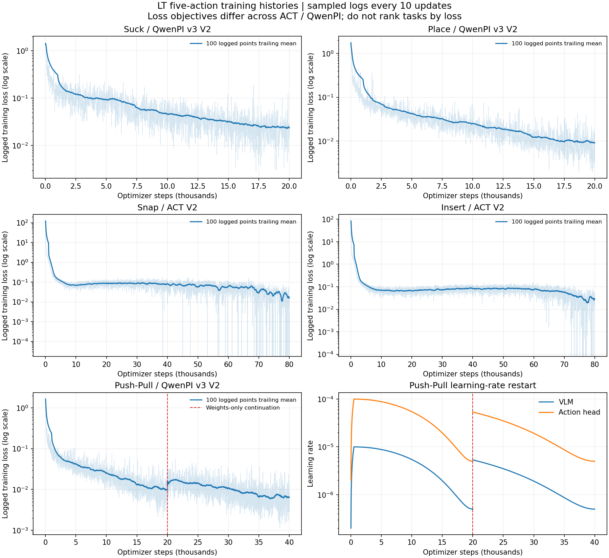
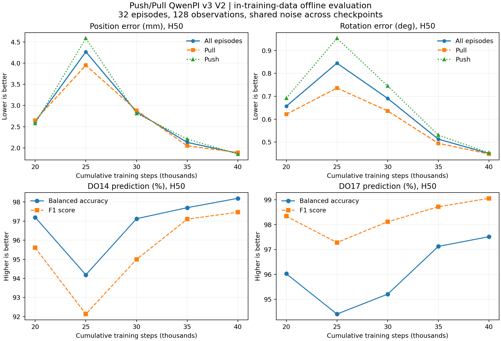

# 2026-11-25 LT 五模型训练与评估记录

主入口：[五模型训练手册](../../TRAINING_HANDBOOK_LT.md)。五个动作是 Suck、Place、Snap、Insert、Push/Pull；Place 使用 QwenPI，Push/Pull 包含原 20k 与续训至总 40k。

## 训练证据

- [sources.json](sources.json)：六段成功运行的实际日志、配置、产物路径和实验参数；Suck 完整日志与双卡 BS4 证据已补齐。
- [training_summary.json](data/training_summary.json)：24,000 条已记录指标的范围、日志 SHA-256、配置 SHA-256、首末 loss、末段均值、循环耗时、最终文件大小。
- `data/*_history.csv`：保留全部已记录数值，每 10 步一个点；没有用旧 H16 / LoRA pilot 替代。
- [Push/Pull 40k 完成配置](data/push_pull_resume40k_config.full.yaml)。
- [环境版本快照](data/current_environment.json)：2026-11-25 采集，不能当作每次历史运行的完整依赖锁。

单动作图：

- [Suck](images/suck_training.png)
- [Place](images/place_training.png)
- [Snap](images/snap_training.png)
- [Insert](images/insert_training.png)
- [Push/Pull 原 20k 和续训 20k](images/push_pull_training.png)

画图入口：[plot_training_logs.py](../../offline_eval/plot_training_logs.py)。细线是完整日志点，深线是后向 100 个点均值，loss 用对数轴；不同策略的 loss 不能横向作为任务能力排名。

## Push/Pull 离线评估证据

| 文件 | 内容 |
|---|---|
| [offline_summary.csv](data/offline_summary.csv) | 20k / 25k / 30k / 35k / 40k 摘要 |
| [offline_metrics.json](data/offline_metrics.json) | H1/H10/H50、分任务、IO 切换附近、两组采样、DO 混淆矩阵、配对区间 |
| [offline_protocol.json](data/offline_protocol.json) | 32 条轨迹、128 观测的 episode / anchor / task 索引、数据和配置指纹 |
| [offline_environment.json](data/offline_environment.json) | A16 / 7GiB CPU 配额、依赖和模型源码 SHA、执行阶段 |
| [per_episode.json](data/per_episode.json) | 轨迹内平均误差，供配对聚类统计 |
| [horizon_errors.json](data/horizon_errors.json) | 各预测步位置、旋转及 DO 错误曲线数值 |
| [checkpoint_sha256.json](data/checkpoint_sha256.json) | 五个原检查点的大小和 SHA-256 |
| [final_equivalence.json](data/final_equivalence.json) | 40k 检查点与已发布最终模型的 1,386 个状态张量完全一致 |
| [frame_verification.json](data/frame_verification.json) | 原始两相机 MP4 抽查与训练图像缓存逐像素一致 |
| [evaluation_receipt.json](data/evaluation_receipt.json) | 原完整评估完成记录，1,280 次 H50 预测 |
| [script_validation.json](data/script_validation.json) | 新 CLI 重算完整数值及 GPU 小样本一致性检查 |
| [prepare_validation.json](data/prepare_validation.json) | cache / 原视频两种准备路径的 8 观测完全相同 |
| [resume_dry_run.json](data/resume_dry_run.json) | 续训工具仅打印计划的验证，未启动训练 |

40k 在本次原训练数据抽样的完整 H50 指标中最好；本批没有独立留出集、真实控制执行或任务成功率。Suck、Place、Snap、Insert 尚无同等多检查点离线预测结果，不以 0 代替缺测。

## 用法

[offline_eval/README.md](../../offline_eval/README.md)提供 `prepare → infer → analyze`、直接重算已有预测、训练日志提取、画图和 20k→40k 续训工具的完整命令。

GitHub 仅保存指标、曲线、配置和脚本。完整原始观测、预测和视频仍在 CS 的 `/root/data/outputs/starVLA/evaluations/push_pull_qwen_20k_40k_20261125/` 以及原始数据目录，没有把原始视频、图像快照或模型大权重复制进 Git。
